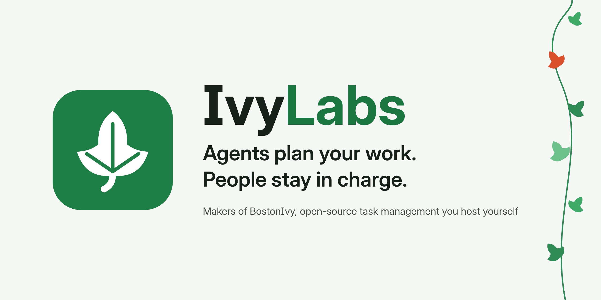

<picture>
  <source media="(prefers-color-scheme: dark)" srcset="./banner-dark.png" />
  
</picture>

[![Design system][design-shield]][design-link]
[![Deployment guide][wiki-shield]][wiki-link]
[![MIT][license-shield]][license-link]

### 👋🏻 Welcome to IvyLabs

IvyLabs builds **BostonIvy**, a to-do and project manager that AI agents plan for people. Your agent lays out the plan — projects, tasks, dates, dependencies — and it takes effect at once; you see who did what, leave notes for the agent, and take any change back in one go. People can do everything by hand too, but every part is built to be easy for agents first: a native API, MCP tools, idempotent retries and a guide written for them.

### ⭐️ BostonIvy

| Part | What it is |
| :--- | :--------- |
| **BostonIvy OS** | The self-hosted server in Rust: REST API, MCP for agents, live updates, webhooks, CalDAV, OIDC sign-in. Runs with Docker Compose or the Helm chart. |
| **BostonIvy Web** | The web app, served on the same origin as the server. |
| **BostonIvy for macOS** | A native app with an Agent workbench: drive Claude Code or Codex on your Mac, hand them your notes, undo a whole round. |
| **BostonIvy for Android** | A native app with a voice assistant for quick capture, agent activity and one-tap undo. |

### 🎨 Ecosystem

| Project | What it is |
| :------ | :--------- |
| [**IvyLabs Design**][design-link] | The design system every BostonIvy app is built on: tokens, icons, components and three styles (Clean, Sticker and Pixel), each in light and dark. |
| [**IvyLabs Wiki**][wiki-link] | How to deploy and run BostonIvy, in several languages. |

[![Back to top][back-to-top]](#readme-top)

<!-- LINK GROUP -->
[design-link]: https://design.ivylabs.app
[design-shield]: https://img.shields.io/badge/design-design.ivylabs.app-3a7d4f?labelColor=black&style=flat-square
[wiki-link]: https://wiki.ivylabs.app
[wiki-shield]: https://img.shields.io/badge/deploy-wiki.ivylabs.app-3a7d4f?labelColor=black&style=flat-square
[license-link]: https://opensource.org/license/mit
[license-shield]: https://img.shields.io/badge/license-MIT-white?labelColor=black&style=flat-square
[back-to-top]: https://img.shields.io/badge/-BACK_TO_TOP-151515?style=flat-square
